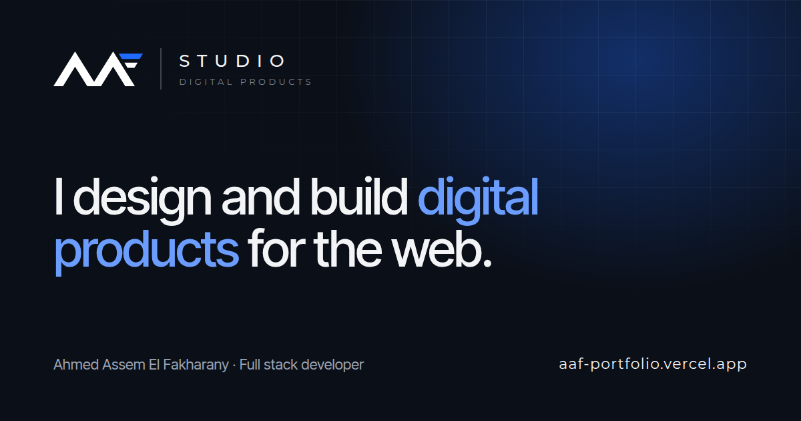

# AAF Studio · Portfolio

**The personal portfolio of Ahmed Assem El Fakharany, a full stack developer and AI automation engineer.**
It's a single-page React and TypeScript site styled as a Windows 95 desktop. It shows 21 of my projects, my
n8n automation workflows and the services I offer.

**[View the live site →](https://aaf-portfolio.vercel.app)**




---

## For reviewers: what this project shows

This repo is a small, finished product. These are the parts most worth a look:

| Area | What I did | Where to look |
| --- | --- | --- |
| **Content kept apart from code** | All copy and project data live in two typed files. Adding a project means adding one object, and the components, filters, counters and archive grid update on their own. | [`src/data/`](src/data) |
| **Canvas game written from scratch** | A Space Invaders scene plays in the empty side margins on wide screens. It has pixel sprites, collision detection, a frame-capped `requestAnimationFrame` loop and a saved high score. It uses no game library and pauses when the tab is hidden. | [`ArcadeGutters.tsx`](src/components/ArcadeGutters.tsx) |
| **Accessibility** | There's a skip link and visible focus rings. Modal windows use the native `<dialog>`, so focus stays trapped and returns to the button that opened them. The Start menu works with the keyboard, and filter counts are announced to screen readers through `aria-live`. The site honours `prefers-reduced-motion`, and a taskbar button pauses every animation. | [`Navbar.tsx`](src/components/Navbar.tsx), [`MoreProjects.tsx`](src/components/MoreProjects.tsx) |
| **Theming without a flash** | Light and dark themes are built on CSS custom properties. A small inline script applies the saved theme before first paint, so the page never flashes the wrong theme. | [`index.html`](index.html), [`index.css`](src/index.css), [`useTheme.ts`](src/hooks/useTheme.ts) |
| **Reusable hooks** | Small custom hooks such as `useInView`, `useActiveSection`, `useTheme`, `useMotion` and `useCopyEmail` hold the shared behaviour, so the components stay mostly declarative. | [`src/hooks/`](src/hooks) |
| **Performance** | Fonts are self-hosted with no third-party requests. Screenshots are lazy-loaded WebP images. Scroll effects use `IntersectionObserver` instead of scroll listeners. The production JS bundle is about 116 KB gzipped. | [`vite.config.ts`](vite.config.ts) |
| **Robust code** | Every `localStorage` and `sessionStorage` call is wrapped in error handling, so the site still works in private browsing. If the clipboard is blocked, copying the email falls back to `mailto:`. Without `IntersectionObserver`, content simply shows instead of breaking. | [`src/hooks/`](src/hooks) |
| **Production setup** | The project uses strict TypeScript, linting with [oxlint](https://oxc.rs), Open Graph and Twitter cards, a web manifest and Vercel Web Analytics. It deploys automatically to Vercel from `master`. | [`package.json`](package.json) |

## Tech stack

| | |
| --- | --- |
| **Framework** | React 19, TypeScript |
| **Styling** | Tailwind CSS v4 (CSS-first `@theme` config), plain CSS for the Windows 95 bevels, CRT effects and keyframes |
| **Build & tooling** | Vite 8, oxlint |
| **Libraries** | lucide-react (UI icons), simple-icons (tech logos), Fontsource (self-hosted fonts) |
| **Hosting** | Vercel, with Vercel Web Analytics |

## Features

- **Windows 95 interface.** Bevelled windows, a taskbar fixed to the top with a working Start menu and
  clock, a "Shut Down" screen, CRT scanlines and pixel and terminal fonts. The light theme is classic
  silver and the dark theme is a deep navy.
- **Boot-up effect.** The first time a window scrolls into view, a short terminal types
  `C:\> RUN PROGRAM.EXE` before the content appears.
- **Project archive as a folder.** The archive is a "My Projects" window: a filterable grid of
  thumbnails with a status bar, where each project opens in its own modal window.
- **Bilingual work.** Projects built in Arabic are tagged RTL, and the spotlight project shows its
  English and Arabic versions side by side.
- **Space Invaders in the margins.** Aliens march down, a cannon picks them off, and hovering over an
  alien zaps it for points.
- **"New Message" notification.** It appears after a short visit, can be minimized or dismissed for the
  session, and moves out of the way while the Contact section is on screen.
- **Responsive** down to phone width (360px).

## Page sections

1. **Hero:** introduction, live stats and a "System Properties" window
2. **Services:** web apps, landing pages, and AI and automation
3. **Selected work:** six featured projects with screenshots, highlights, and live and source links
4. **Archive:** every project, filterable by React and TypeScript, JavaScript, websites and backend
5. **Templates:** digital products available on my store
6. **Automation:** n8n workflows (a WhatsApp chatbot, a document Q&A chatbot, invoice processing)
7. **About & Contact**

### Featured projects

| Project | What it is | Stack |
| --- | --- | --- |
| [Ibdaa Albashq](https://ibdaa-albashk.vercel.app/) | Bilingual (EN/AR) corporate website for a contractor | React 19, TS, React Router, TanStack Query, Vitest |
| [TechMart](https://project17-tech-mart-qf9g.vercel.app) | E-commerce store with auth, cart and checkout | Next.js 16, NextAuth, shadcn/ui, Zod |
| [Lumen](https://project-ai-saa-s-landing-page-templ.vercel.app) | AI SaaS landing page template | React 19, TS, Tailwind v4 |
| [The Keepsake Club](https://the-keep-sake-club.vercel.app) | Gift shop landing page with ordering by Instagram DM | React 19, TS, Framer Motion |
| [Circle](https://project16-circle-psi.vercel.app/signin) | Social posting app with protected routes | React, TS, React Hook Form, Zod, Axios |
| [NutriPlan](https://project12-nutri-plan.vercel.app/) | Nutrition planner with barcode lookup and charts | JavaScript, REST APIs, Plotly |

The full list of 21 projects is on the [live site](https://aaf-portfolio.vercel.app/#projects).

## Project structure

```
src/
├── data/
│   ├── site.ts         ← name, links, stats, services, process, skills
│   └── projects.ts     ← featured projects, n8n workflows, archive (typed with a Project interface)
├── components/         ← one file per page section (Hero, FeaturedWork, MoreProjects, …)
│   └── ui/             ← shared building blocks (Window, Reveal, CountUp, TechIcon, Logo, …)
├── hooks/              ← useTheme, useMotion, useInView, useActiveSection, useCopyEmail
├── assets/projects/    ← project screenshots (WebP, 1200px wide)
├── index.css           ← design tokens, light and dark themes, Windows 95 components, animations
└── main.tsx
```

## Running locally

Requires Node.js 20.19 or later.

```bash
git clone https://github.com/Ahmed-Assem99/AAF-Portfolio.git
cd AAF-Portfolio
npm install
npm run dev
```

| Command | Description |
| --- | --- |
| `npm run dev` | Start the dev server |
| `npm run build` | Type-check and build for production |
| `npm run preview` | Preview the production build |
| `npm run lint` | Lint the code with oxlint |

### Adding or editing content

You rarely need to touch a component:

- **Text, links and skills:** edit [`src/data/site.ts`](src/data/site.ts).
- **A new project:** save a 1200px-wide WebP screenshot in `src/assets/projects/`, import it at the top
  of [`src/data/projects.ts`](src/data/projects.ts), and add an entry to `featuredProjects` or
  `moreProjects` (and to `archiveOrder`). The live-demo count, filters and archive update on their own.

## About me

I'm Ahmed Assem El Fakharany, a full stack developer based in Egypt and working worldwide. I build
React and TypeScript web apps, backends in Node and Python, and the AI automations that connect them.

- **Portfolio:** [aaf-portfolio.vercel.app](https://aaf-portfolio.vercel.app)
- **GitHub:** [@Ahmed-Assem99](https://github.com/Ahmed-Assem99)
- **Store:** [ahmedassem0.gumroad.com](https://ahmedassem0.gumroad.com)

I'm open to full-time roles and freelance projects. Get in touch through the Contact section of the
live site.
